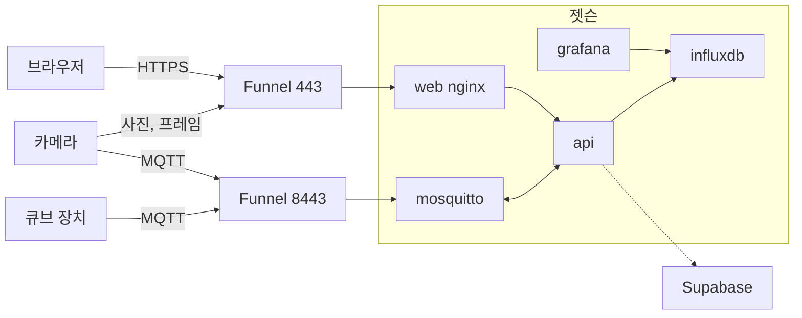
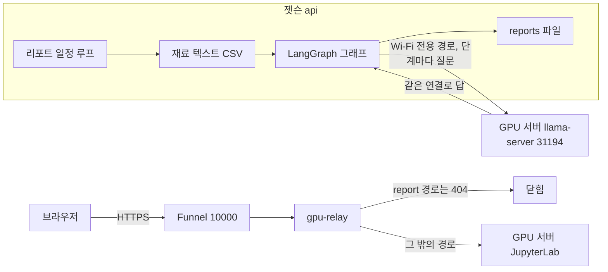

# helpai

젯슨(Jetson Xavier NX) 엣지 서버의 **코드와 설정**이다. 젯슨 `/data` 에서 비밀값(`.env`)·시계열 DB 파일·카메라 사진·리포트 결과·손 백업 사본·화면 빌드 산출물을 뺀 것만 담았다(제외 목록은 `.gitignore`). 전체 구조는 설계서 v5(`edgeserver-JS/2026-10-07_엣지서버_설계서v5_랩탑ClaudeCode.md`)를 따르며, 이 README 는 그 요약이다. 설계서와 다르면 설계서가 우선한다.

> 성격: primary User 의 개인 실험 서버. 비밀번호·토큰·키는 젯슨 `/data/.env`, 펌웨어 `secrets.h`, Supabase 콘솔에만 있고 이 저장소에는 없다.

---

## 1. 한 장 요약





- **센서값**: 장치 → Funnel 8443(TLS) → 브로커 → api 가 원본 프레임을 풀어 메모리(큐브별 최신값)에 두고 InfluxDB 에 기록 → 화면·Grafana 가 조회.
- **화면**: 브라우저 → Funnel 443 → nginx → 정적 화면 + `/api/`·`/i/<iid>/api/` → api. 지금은 로그인 인증 우회 상태(§8).
- **제어**: 화면(사람) 또는 자동 제어(api 안) → 같은 송신 함수 → 브로커 `notify/control` → 장치 → `ack`.
- **AI 리포트**: api 가 매일 02:00 에 하루치 재료(CSV 텍스트)를 만들고 api 안의 LangGraph 그래프로 작성한다. GPU 서버의 llama-server 는 추론만 빌려준다. 결과는 젯슨 파일.
- **GPU 서버 JupyterLab**: Funnel 10000 → gpu-relay → Wi-Fi 전용 경로 → GPU 서버. `/report/` 는 404.

---

## 2. 저장소 폴더 구성

```
.
├── docker-compose.yml          서비스 6개 정의 (§3)
├── .env.example                환경변수 이름과 설명 (값 없음, §11)
├── api/                        api 0.9.2 소스 — FastAPI + LangGraph
│   ├── app/                    모듈 13개 (§6)
│   ├── Dockerfile, requirements.txt
│   ├── README.md               api 변경 이력 v0.1 ~ v0.9 (라우트·시험 결과)
│   └── compose.snippet.yml, nginx.snippet.conf   초기 골격 때의 참고 조각
├── nginx/
│   ├── default.conf            web 컨테이너: 화면 + api 프록시 (§9)
│   └── gpu-relay.conf          gpu-relay 컨테이너: Funnel 10000 → GPU 서버 JupyterLab (§9)
├── mosquitto/config/mosquitto.conf   브로커 설정 (동적 보안 플러그인)
├── grafana/provisioning/
│   ├── datasources/influxdb.yml      InfluxDB 데이터소스 (읽기 토큰)
│   └── dashboards/                   provider.yml, smartcube.json, device.json(생성기 산출물)
├── tools/                      설치·시험·생성 스크립트 (§12)
├── bridge/, telegraf/          09-28 compose v3 에서 제거된 컨테이너의 설정 (참고용)
└── .gitignore
```

젯슨 `/data` 에는 위 외에 다음이 더 있다. 모두 저장소에서 제외했다.

| 젯슨 경로 | 내용 | 제외 이유 |
|---|---|---|
| `/data/.env` | 접속 정보(권한 600) | 비밀값 |
| `/data/mosquitto/config/dynamic-security.json`·`passwd`, `data/`, `log/` | 브로커 계정·ACL, 보존 데이터, 로그 | 비밀값·상태 |
| `/data/influxdb/` | 시계열 DB 파일과 설정(전권 토큰 포함) | 비밀값·상태 |
| `/data/grafana/data/` | Grafana 내부 DB | 상태 |
| `/data/web/` | 화면 빌드 산출물(소스는 `fr/`) | 빌드 산출물 |
| `/data/snapshots/` | 카메라 사진 `<iid>/<큐브>/<카메라>/<날짜>/<시각>_<트리거>.jpg` + `.json` | 데이터 |
| `/data/reports/` | AI 리포트 `<iid>/<큐브>/settings.json`, `<날짜>/<작업 ID>.job.json`·`.json`·`.input.txt` | 데이터 |
| `/data/backup/`, `*.bak-<시각>`, `api_backup_*`, `web.bak-*` | 배포 때 만든 손 백업 | 깃 이력이 대신함 |
| `/data/docker/` | 도커 data-root | 상태 |

랩탑 쪽 짝(이 저장소에 없음): `edgeserver-JS/deploy/deploy.sh`(배포 스크립트), `edgeserver-JS/supabase/`(표·훅 SQL, 절차), `edgeserver-JS/esp32/`(장치·카메라 펌웨어), `fr/`(화면 소스).

---

## 3. 서비스 구성 (docker compose, 6개)

| 서비스 | 이미지 | 호스트 포트 | 볼륨 | 역할 |
|---|---|---|---|---|
| mosquitto | eclipse-mosquitto:2 | 127.0.0.1:1883 | config·data·log | MQTT 브로커, 동적 보안 플러그인 |
| influxdb | influxdb:2.7 | 127.0.0.1:8086 | data·config | 시계열 DB(org `smartcube`, bucket `sensors`) |
| grafana | grafana/grafana:10.4.2 | 3000 | data·provisioning(읽기) | 운영자 대시보드(읽기 토큰) |
| web | nginx:1.27-alpine | 80 | `/data/web`(읽기), `default.conf`(읽기) | 화면 + api 프록시 |
| api | smartcube-api:2 (`/data/api` 빌드, 0.9.2, LangGraph 포함) | 없음(8000 내부) | `/data/snapshots`, `/data/reports` | §6 |
| gpu-relay | nginx:1.27-alpine | 127.0.0.1:10080 | `gpu-relay.conf`(읽기) | Funnel 10000 → GPU 서버 JupyterLab. `/report/` 404 |

공통: `restart: unless-stopped`, 서비스 이름 DNS. 재부팅 뒤 전부 자동 복구.

**바인드 마운트 규칙**: 컨테이너에 연결된 파일·폴더는 바꿔치기(`install`·`mv`·`rm+mv`)하지 않고 `cp` 로 덮어쓰거나 내용물만 바꾼다. `.env` 를 바꾸면 해당 서비스를 `docker compose up -d <서비스>` 로 다시 만들어야 반영된다. `.env` 값에 `$` 를 넣지 않는다.

---

## 4. 네트워크와 공개 경로

| 인터페이스 | 용도 |
|---|---|
| 유선(eth0) | 기본 경로 |
| 무선(wlan0, 2.4 GHz 동글) | GPU 서버 전용 경로. 유선에서는 GPU 서버에 닿지 않는다. JupyterLab 중계와 AI 리포트 LLM 호출이 모두 이 경로 |
| tailscale0 | 관리자 SSH·터널, Funnel |

Funnel(Tailscale 공개 입구)은 443·8443·10000 세 포트만 쓸 수 있고 셋 다 사용 중이다.

| 공개 주소 | 넘기는 곳 | 용도 |
|---|---|---|
| `https://helphyai-jetson.tail3126a6.ts.net` (443) | 127.0.0.1:80 (web) | 화면, `/api/`, 카메라 업로드(`/api/dev/…`) |
| `tcp://…:8443` (TLS 종단) | localhost:1883 (mosquitto) | 장치·카메라 MQTT |
| `https://…:10000` | 127.0.0.1:10080 (gpu-relay) | GPU 서버 JupyterLab. `/report/` 는 404 |

열린 포트: 22 sshd(키 인증), 80 web, 3000 grafana, 1883·8086·10080 은 127.0.0.1 전용, 443·8443·10000 은 tailscaled. api 의 8000 은 호스트에 없고 컨테이너 내부망만.

외부 의존: Supabase(로그인·등록부·브로커 비밀·조작 기록), GPU 서버(JupyterLab 31355, AI 리포트용 llama-server 31194), Tailscale(Funnel·관리자 접속).

---

## 5. 장치와 MQTT

| SN | 보드 | 맡은 것 |
|---|---|---|
| CUBE001 | ESP32 DevKitC | 센서(온습도·조도·토양 수분·칩 온도), 출력(배기팬 fan1, 급수 펌프, LED) |
| CUBE002 | ESP32-CAM | LED 임시판. CUBE001 과 같은 큐브로 본다 |
| CUBE001-C1~C3 | ESP32-CAM | 사진·스트리밍. MQTT 는 인스턴스 계정, 사진·프레임은 443 `/api/dev/…`(HTTP Basic) |

펌웨어 소스는 `edgeserver-JS/esp32/`(이 저장소 밖).

| 방향 | 토픽 | 내용 |
|---|---|---|
| 장치 → | `device/helpai.cube/<SN>/public` | 텔레메트리(5초) |
| 장치 → | `device/helpai.cube/<SN>/status` | 상태(펌웨어·보정값·진단 모드 등) |
| 장치 → | `device/helpai.cube/<SN>/ack` | 제어 응답 |
| → 장치 | `device/helpai.cube/<SN>/notify/control` | 제어 7키 `session·seq·pump·led1·led2·fan1·fan2` |
| → 장치 | `device/helpai.cube/<SN>/notify/config` | 토양 보정, 카메라 명령 |
| → 장치 | `device/helpai.cube/<SN>/notify/public` | 지금 텔레메트리 요청 |
| → 그룹 | `device/helpai.cube` | 빈 메시지 = 전 장치 status 요청(api 접속 때) |

- 프레임 = 아라온실 VALUE v1: `FF A3 01 01 | 옵션 길이(4B) | "data-type=application/json" | 본문 길이(4B) | JSON`. 인코딩·해석은 `api/app/agframe.py`.
- 순번: api 가 큐브별 마지막 순번을 들고 있고, 장치는 이전 이하 순번을 거부한다. keepalive 30초, QoS 0, retained 없음.
- 브로커 계정(동적 보안 플러그인): `smartcube` = admin(api), `<인스턴스 ID>` = 그 인스턴스의 큐브·카메라 토픽만, `cube001` = 옛 계정 유지. 비밀번호는 Supabase `instance_secrets` 에 보관하고 api 가 자동 생성·재발급한다(`broker_admin.py`).

---

## 6. api (FastAPI 0.9.2, `api/app/`)

| 파일 | 역할 |
|---|---|
| `main.py` | MQTT 수신 스레드 → 프레임 해석 → 큐브별 최신값 + 기록기, 세션·순번, 공용 송신 함수, 이력 조회, 라우트 대부분, 기동·종료 |
| `agframe.py` | VALUE v1 프레임 인코딩·해석 |
| `auth.py` | Supabase JWT 검증, `AUTH_MODE`, 소유자·운영자 판정, 운영자 마스터 키 |
| `registry.py` | Supabase `instances`·`cubes`·`cameras` 기동 때 적재 + 60초 재적재, 큐브 설정 쓰기, 자동 등록 |
| `writer.py` | InfluxDB 기록(쓰기 토큰, 2초 또는 200점 배치, 재시도 5회) |
| `audit.py` | Supabase `audit` 비동기 기록 |
| `broker_admin.py` | 동적 보안 플러그인으로 인스턴스 계정·역할·ACL 관리 |
| `camera.py` | 사진 저장·조회, 즉시 촬영 대기, 스트림 프레임 중계, 주기 촬영 시각 |
| `crops.py` + `crops.json` | 작물표 읽기·검사(현재 `rose`) |
| `autoctl.py` | 작물 기반 규칙 자동 제어(10초 루프, §10) |
| `report.py` | AI 리포트 일정·회차·작성·라우터(§10) |
| `report_material.py` | AI 리포트 재료 텍스트(CSV) |
| `report_graph.py` | AI 리포트 LangGraph 그래프·LLM 호출 |

기동 때 시작하는 루프: 카메라 주기 촬영(20초 확인), 등록부 재적재(60초), 자동 제어(10초), 리포트 일정(15초 + 요청 때 곧바로).

| 라우트 묶음 | 예 | 조건 |
|---|---|---|
| 전역 `/api/…` | `GET /health` · `GET /me` · `POST /claim {sn}` | 공개 / 로그인 / 로그인 |
| 인스턴스 조회 `/i/<iid>/api/…` | `instance/status` · `cubes` · `cubes/{sn}/values·status·history·stream` · `cameras` · `cubes/{sn}/snapshots` · `crops` · `cubes/{sn}/auto` · `cubes/{sn}/reports` | 소유자 또는 운영자 읽기 |
| 인스턴스 조작 | `POST cubes` · `cubes/{sn}/control·refresh·config` · `broker`·`broker/rotate` · `cubes/{sn}/snapshot` · `cameras/{cam}/stream/start·stop` · `PUT cubes/{sn}/crop·auto·report-settings` · `cubes/{sn}/reports/now` | 소유자 |
| 운영자 | `POST·GET·DELETE operator/access` | 마스터 키 + 사유, 60분 읽기 |
| 장치 `/api/dev/…` | `cameras/hello` · `snapshots` · `frames` | HTTP Basic = 인스턴스 브로커 계정 |

전체 라우트와 버전별 변경은 `api/README.md`.

---

## 7. 데이터

**InfluxDB**: org `smartcube`, bucket `sensors`, 보존 무제한. 토큰은 전권(초기화·관리)·쓰기 전용(api 기록)·읽기 전용(api 조회·Grafana) 세 종류. measurement `mqtt`, 태그 `cube=<SN>`·`kind=data/status/ack`, 필드는 숫자만. 젯슨 밖에서는 SSH 터널(`ssh -N -L 127.0.0.1:8086:127.0.0.1:8086 jetson`)로 접속.

**Supabase 표**: `profiles`, `instances`(id·owner_id·name), `cubes`(sn·instance_id·crop_id·auto_mode), `cameras`, `operators`, `instance_secrets`(브로커 비밀번호), `audit`(조작 기록). SQL 은 `edgeserver-JS/supabase/`.

**파일**(젯슨, 저장소 제외): `/data/snapshots/…`(사진 + 촬영 순간 텔레메트리), `/data/reports/…`(리포트 설정·회차·결과·입력 텍스트).

---

## 8. 인증·권한

- 스위치는 `.env` 의 `AUTH_MODE` 하나. **지금 `off`**(프로토타입 기간). 모든 요청을 모든 인스턴스의 소유자로 통과시키고 조작 기록 계정은 `local@auth-off`. 화면은 `/health` 의 `auth_mode` 를 읽어 로그인 화면을 건너뛴다.
- `required` 로 켜면: 구글 로그인 → Supabase 가 접근 토큰(JWT 60분) 발급 → api 는 토큰 서명·만료만 검사(요청마다 Supabase 조회 없음).
- 대시보드 이용자 = 그 인스턴스의 소유자. 비소유자는 보기도 불가. 운영자는 마스터 키 + 사유로 인스턴스별 60분 읽기.
- 첫 구글 로그인 + 큐브 SN → `POST /claim` → 인스턴스·큐브·브로커 계정 자동 생성.
- 장치: 브로커 = 인스턴스 계정, 카메라 업로드 = 같은 계정의 HTTP Basic. 젯슨 → LLM 서버는 Bearer 키.

---

## 9. nginx 라우팅

**web** (`nginx/default.conf`, 443 → 80)

| location | 동작 |
|---|---|
| `/` | 화면(SPA, 모르는 경로는 `index.html`) |
| `/assets/` | 빌드 자산, 7일 캐시 |
| `^~ /api/report/` | 404 |
| `/api/` | `api:8000/<나머지>`(변수 upstream + 도커 DNS 재조회, 버퍼링 끔) |
| `~ "^/i/([a-z0-9][a-z0-9_-]{0,63})/api/(.*)$"` | `api:8000/i/<iid>/<나머지>` |

**gpu-relay** (`nginx/gpu-relay.conf`, 10000 → 10080)

| location | 동작 |
|---|---|
| `^~ /report/` | `return 404`(블록을 지우면 `/` 로 넘어가므로 남긴다) |
| `/` | GPU 서버 JupyterLab(자체 로그인). Host 보존, WebSocket 전달, 버퍼링 끔, 3600초, 100 MB |

---

## 10. api 안의 기능

**작물 기반 규칙 자동 제어** (`autoctl.py`, 10초 루프)
- 작물표 `crops.json`(현재 `rose`): 주간·야간 온도·습도, 토양 수분, 광주기, 주간 목표 조도. 큐브 설정은 Supabase `cubes.crop_id`·`auto_mode`.
- 규칙: 배기팬 0→33→66→100 단계, 급수 5초 펄스·재급수 대기 60분·하루 4회, LED 주간 조도 목표·야간 0, 센서 끊김 = 출력 유지 + "센서 점검 필요", 연속 5회 실패 = 일시 정지.
- 사람이 `control` 로 조작하면 그 큐브의 자동 제어가 꺼진다. 명령을 보낼 때만 audit `auto_control`.

**AI 리포트** (`report.py`·`report_material.py`·`report_graph.py`)
- 역할 분담: 재료 만들기·LangGraph 그래프·작성·저장은 젯슨 api 안, GPU 서버 llama-server 는 LLM 추론만.
- 한 회차: 재료 조회(InfluxDB 10분 평균 + Supabase 자동 제어 기록 + 작물 정보) → CSV 텍스트 → 그래프 단계마다 LLM 질문 → 결과 JSON 저장.
- 정기 회차 02:00(KST), 02:00~02:10 1분 간격, 못 끝내면 02:30~02:40, 그래도 못 끝내면 `failed`. 중간 실패는 처음부터. 간격 1~30일(기본 1일), 길면 하루치마다 회차를 따로. "받기" = 최대 24시간 범위 즉시 회차.
- 상태 `pending` → `writing` → `done` / `failed`. 그래프는 지금 임시 1단계 `draft`(리포트 내용은 팀 회의 뒤 결정).

**카메라** (`camera.py`)
- 큐브당 여러 대, SN `<큐브 SN>-C<n>`. 첫 hello/업로드 때 자동 등록 또는 장치 연결 페이지에서 추가.
- 사진: 09:00·21:00 KST 에 전 카메라 촬영 명령. 즉시 촬영은 개발자 도구에서만, 업로드 대기 60초(`SNAPSHOT_TIMEOUT`).
- 스트리밍: 열면 시작·닫으면 정지, 시청자 0 이 15초 또는 300초 초과면 정지. 프레임 저장 안 함.

---

## 11. 환경변수

이름과 설명은 `.env.example`. 값은 젯슨 `/data/.env` 에만 둔다.

| 묶음 | 변수 |
|---|---|
| 브로커 | `MQTT_USER`, `MQTT_PASSWORD`, `AG_APP=helpai.cube`, `BROKER_ADMIN=1`, `BROKER_PUBLIC_HOST`, `BROKER_PUBLIC_PORT=8443` |
| InfluxDB | `INFLUX_WRITE_TOKEN`, `INFLUX_READ_TOKEN`, `WRITER_ENABLED=1` (초기화용 `INFLUX_PASSWORD`, `INFLUX_TOKEN`) |
| 인증·등록부 | `AUTH_MODE`, `SUPABASE_URL`, `SUPABASE_SERVICE_KEY`, `SUPABASE_JWT_SECRET`(빈 값 = JWKS), `OPERATOR_MASTER_KEY`, `OPERATOR_GRANT_MINUTES=60`, `REGISTRY_RELOAD_SECONDS=60` |
| 카메라 | `SNAPSHOT_DIR=/data/snapshots`, `SNAPSHOT_TIMES="09:00,21:00"`, `SNAPSHOT_TIMEOUT=60`, `STREAM_MAX_SECONDS=300` |
| AI 리포트 | `REPORT_DIR=/data/reports`, `REPORT_LLM_URL`, `HELPAI_LLM_KEY`, `REPORT_EVERY=10m`, `LANGSMITH_TRACING="false"` |
| 기타 | `TZ=Asia/Seoul`, `GRAFANA_PASSWORD`, `CUBE001_PASSWORD`, `INSTANCE_ID`(미사용) |

compose 에 값이 직접 있는 것과 `.env` 에서 읽는 것의 구분은 `docker-compose.yml` 의 주석 참조.

---

## 12. tools/ 와 운영

| 스크립트 | 용도 |
|---|---|
| `setup.sh` | 젯슨 엣지 서버 스택 설치(docker compose + `/data` 레이아웃 + 초기 계정 생성) |
| `migrate_nvme.sh` | `/data` 를 SD 카드에서 NVMe 로 이전 |
| `make_device_account.sh` | 장치 전용 브로커 계정 생성 + 펌웨어 `Secrets.h` 생성(동적 보안 플러그인 이전 방식) |
| `recreate_bucket.sh` | `sensors` 버킷 재생성 + 모의 데이터 재삽입 |
| `fake_device.py` | ESP32 대역 시험 발행기(VALUE v1 프레임) |
| `gen_demo_data.py` | Grafana 확인용 모의 데이터(line protocol) |
| `gen_dashboard.py`, `gen_device_dashboard.py` | Grafana 대시보드 생성기. `grafana/provisioning/dashboards/device.json` 은 생성기 산출물이라 손으로 고치지 않는다 |

운영 요점:
- 배포는 랩탑의 `edgeserver-JS/deploy/deploy.sh {check|compose|api|web|nginx|all}`(백업 → 복사 → 빌드·재기동 → 확인). gpu-relay 설정은 `scp` → 백업 → `cp` 덮어쓰기 → `nginx -t` → reload.
- 자주 쓰는 명령(젯슨): `cd /data && docker compose ps`, `docker logs -f --tail 50 api`, `docker exec web wget -qO- http://api:8000/health`.
- 로그 시각: api 는 KST, mosquitto·grafana·nginx 는 UTC.
- 인증 다시 켜기: `.env` 의 `AUTH_MODE=off` → `required` 로 바꾸고 `docker compose up -d api`.

---

## 13. 관련 문서 (이 저장소 밖, `edgeserver-JS/`)

- 설계서(정본): `2026-10-07_엣지서버_설계서v5_랩탑ClaudeCode.md` (이전판 v1~v4 보존)
- 작업 일지: `2026_09_16 엣지 서버 작업 일지.md`
- 계획서: AI 리포트 v4, 작물 기반 자동 제어, 카메라 스냅샷·스트리밍
- 배포·설정: `deploy/deploy.sh`, `config/docker-compose.v3.yml`, `config/nginx/`, `config/env.v3.example`, `supabase/`
- 펌웨어: `esp32/esp32_devkit_node/`, `esp32/esp32_cam_node/`, `esp32/cam-api/`
- 화면: `../fr/`
