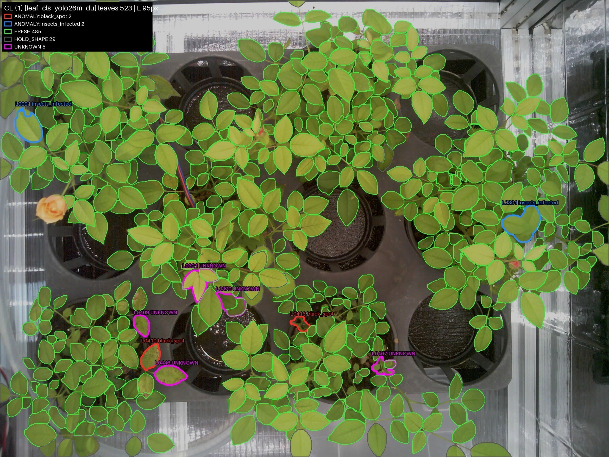
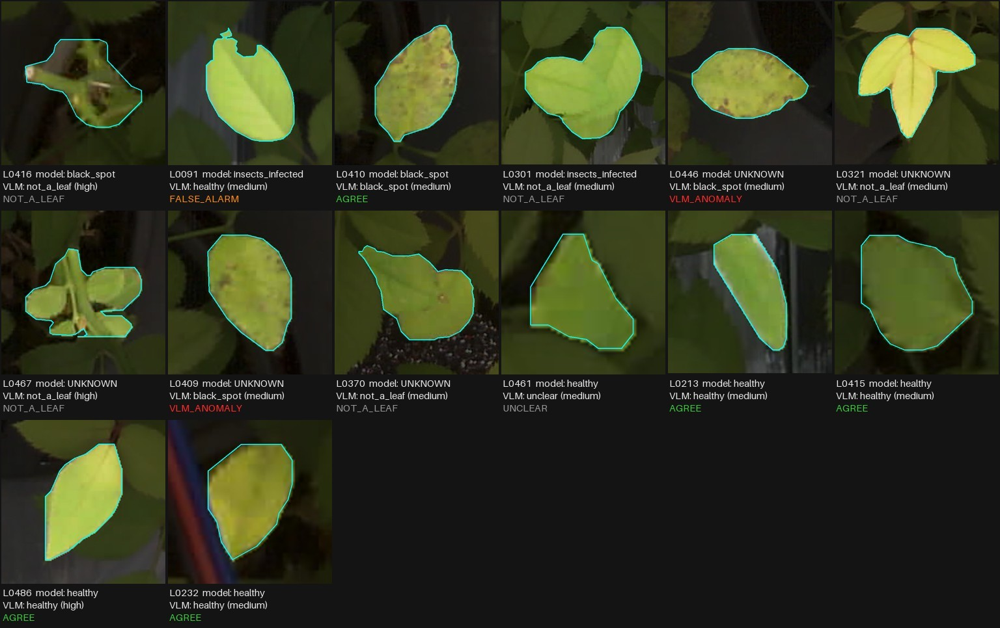
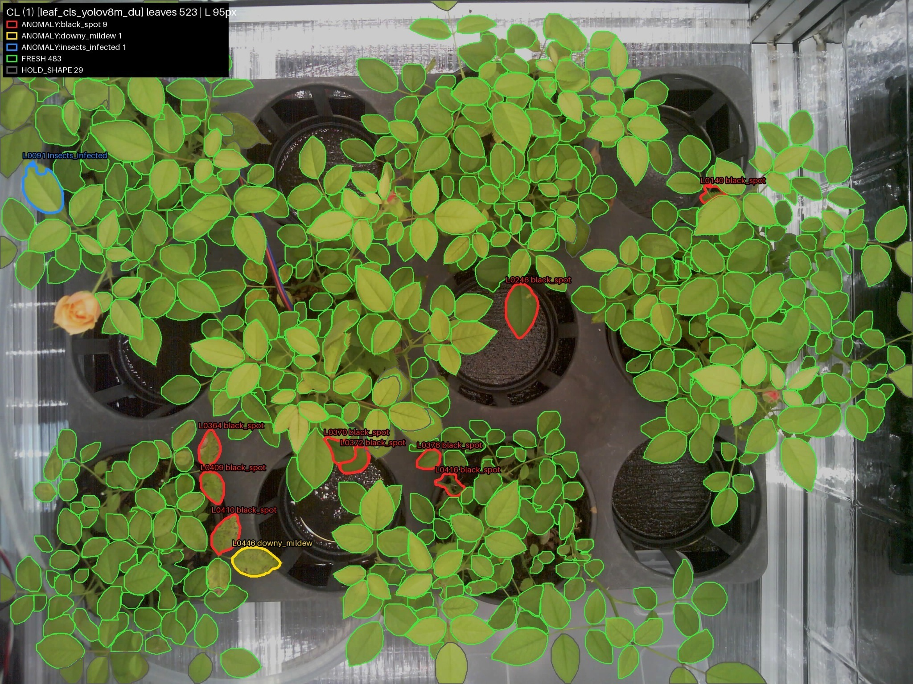
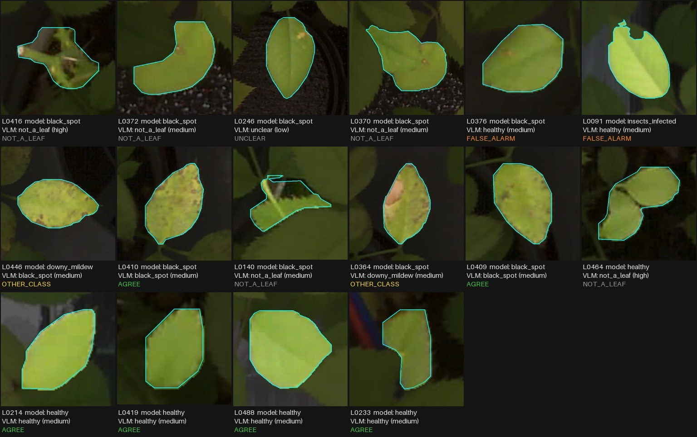

# 장미 잎 이상 탐지 프로젝트 정리

Nov 19, 2026 · @지후

## 개요

장미 잎 사진을 보고 정상 / 흑점병 / 노균병 / 해충 피해를 판정하는 모델이다. 최신 구성은 **FastSAM으로 잎을 한 장씩 분리한 뒤 YOLO11 분류 모델로 잎마다 판정**하는 방식이며, 화분·온실 사진에서도 잎별 결과를 낸다.

| 항목 | 현재 상태 |
| --- | --- |
| 최신 노트북 | `rose_yolo_fastsam_cls_merged_colab.ipynb` (바탕화면/Rose Leaf Merged Project) |
| 학습 데이터 | Rose Leaf Merged 28,900장 (2026-11-18 이상 잎 흑점병 943장 추가). 분할 train 12,077 · val 2,683 · test 2,812 |
| 판정 모델 | YOLO11n-cls (기본). Merged 데이터로 분류 모델 9종을 비교해 **yolov8m-cls(사진 단위 97.7%)와 yolo26m-cls(97.2%)를 선정**. helpai 패키지(rose\_leaf\_colab)에는 yolov8m-cls 를 적용했고, 추가 데이터로 재학습한 yolov8m-cls · yolo26m-cls 도 골라 쓸 수 있다 (2026-11-18) |
| 화분 사진 오판 | Merged 학습 후 화분 잎(own crops) 정상 잎 오판율 0.3–0.7%. 같은 화분 사진(잎 282장)에서 이상으로 본 잎 85장 → 0–5장 |
| 남은 과제 | 사진 1장 추론 7–8분 단축, 노균병 잎 재현율(약 0.6), yolo11-seg 시도, excluded 사본 활용, 화분별 결과 연결 |
| 데이터 출처 | Mendeley Data 장미 잎 데이터셋 (https://data.mendeley.com/datasets/mdtpp2cmj4/1) + 직접 찍은 화분 사진 |
| 진행 기간·환경 | 2026-10-12 \~ 10-28 (1–9단계), 2026-11-04 \~ 11-18 (10단계). Google Colab (모델 비교는 A100 GPU) |

## 데이터셋

학습 데이터는 기존 Without Augment 2,048장에서 Rose Leaf Merged 27,957장으로 바뀌었다. 모든 사진이 흰 배경 위 떼어낸 잎 1장이라, 화분 사진과의 차이가 남은 오판의 주원인이다.

| 출처 | 장수 | 내용 |
| --- | --- | --- |
| Without Augment | 2,048 | 원본. 흑점병 432장은 이미 증강된 224×224 저해상도, 나머지는 3024×4032 원본 |
| Augment Class | 20,480 | 원본의 10배 증강 사본 (회전·크기·색 변형, 224×224). 파일명에 원본 정보 없음 |
| own crops | 5,429 | 화분 사진 25장에서 잘라낸 잎 (정상 5,365 · 흑점병 52 · 해충 9 · 노균병 3) |

| 클래스 | 폴더 | Merged 장수 |
| --- | --- | --- |
| 정상 (healthy) | Pure | 14,110 |
| 흑점병 (black\_spot) | Black spot | 4,804 |
| 해충 피해 (insects\_infected) | Insects Infected | 4,750 |
| 노균병 (downy\_mildew) | Downy mildew | 4,293 |

- 하나의 원본에서 나온 사진이 train과 test에 갈리면 점수가 부풀려져, 모든 분할은 **같은 잎 묶음 단위**로 한다.
- 흑점병 원본 자체가 증강본이라 같은 잎이 여러 장 들어 있었고, 이전 프로젝트 test 점수는 다소 높게 나왔을 수 있다.

## 진행 이력

분류 → 탐지 → 세그멘테이션+탐지 → FastSAM 잎 분리 + 잎별 분류 순서로 발전했고, 각 단계는 앞 단계에서 드러난 문제를 고친 것이다.

| 버전 | 변경 | 결과·발견 |
| --- | --- | --- |
| v18 | helpai 패키지에 API 키를 파일(`ANTHROPIC_API_KEY`)에서 읽는 노트북 `rose_leaf_colab_keyfile.ipynb` 추가, 두 노트북에 API 키 넣는 방법 안내 칸 추가 (2026-11-19) | 패키지 zip 은 그대로. 키 파일 노트북을 Colab(T4)에서 실제 키로 끝까지 실행: CL (1).jpg 이상 5 → VLM 일치 4 · 종류 다름 2 · 잎 아님 2 · 오경보 1 · 판단 불가 1, 약 $0.11 |
| v17 | 추가 데이터로 yolov8m-cls · yolo26m-cls 재학습, helpai 패키지에 분류 모델 3종 선택과 VLM 검증 추가 (2026-11-18) | test top-1 92.75% / 92.57%, 이상 정밀도 99.27% / 97.65%, 화분 정상 잎 오판 0.3% / 1.0% (yolov8m / yolo26m) |
| v16 | 이상 잎 추가 데이터: 화분·화단 사진 49장에서 흑점병 943장을 Black spot 에 추가 (2026-11-18) | Black spot 4,804 → 5,747장, own crops 흑점병 52 → 995장, 분할 12,077 / 2,683 / 2,812 |
| v15 | helpai 잎 탐색 패키지(rose\_leaf\_colab)의 2단계 분류를 YOLOv8m-cls 로 교체 (2026-11-04) | 1단계 세그멘테이션 모델은 유지, 판정 기준은 기존 값 재사용. test 정확도 약 0.93 |
| v14 | 같은 설정으로 2차 재측정, yolo26m-cls 추가, 사진 1장 추론 시간 측정 | 같은 seed 재학습 결과 완전히 동일, yolo26m-cls 사진 단위 97.2%, 추론 7–8분/장 (A100) |
| v13 | Merged 데이터로 분류 모델 8종 비교 (YOLO11 · YOLOv8 · YOLO26 의 n/s/m, 30 epoch) | yolov8m-cls 사진 단위 97.7%, 이상 재현율 95.3%, 화분 정상 잎 오판 0.3% |
| v12 | Rose Leaf Merged 프로젝트: 증강 사본-원본 SIFT 연결, 묶음 단위 분할, cache=ram · workers=cpu 수 | 사본 9,152장 연결, 11,328장 excluded |
| v11 | 판정 기준 MIN\_LEAF\_PX 100, MAX\_PHOTO\_SIDE 4000, 저해상도 사본 2장 (v3) | 2560px 사진은 잎이 커짐, 2048px 사진은 효과 없음 |
| v10 | 저해상도·가림 증강, MIN\_LEAF\_PX 80, ALERT\_CONF 0.8 (v2) | 화분 사진 오판 39.4% → 9.4% |
| v9 | ③을 객체 탐지 → 분류(YOLO11n-cls)로 변경 | 흰 배경 test 흑점병 재현율 88% |
| v8 | 1단계 seg 모델 제거, FastSAM만으로 학습·판정, 잎 뭉치 판단 규칙 | 사용자 사진 잎 8장 → 161장 분리 |
| v7 | 학습 데이터 배경 제거 A/B 비교 | 병반이 잎에서 지워지는 버그 발견·수정 |
| v6 | ①잎 영역 → ②개별 잎 → ③탐지 3단계 구조 | 화분 사진 잎 170장 분리 |
| v5 | 범용 분할 모델(FastSAM, SAM 2.1) 도입 | FastSAM이 SAM 2.1보다 잎 7배, 속도 170배 |
| v4 | 세그멘테이션 → 배경 제거 → 탐지 | 사진 단위 76.8%, 흑점병 재현율 13.8%, 화분 사진에서 식물 전체가 잎 1장 |
| v3 | 자동 박스 라벨로 객체 탐지 | 잎 단위 탐지, 병변 단위 아님 |
| v2 | 잎 크롭 + 약한 증강 (분류) | 로컬 결과는 데이터 누락으로 무효 |
| v1 | YOLO11n-cls 분류 (CPU 10 epoch) | 4클래스 76.1%, 흑점병 재현율 21.5% |

### 진행 보고서 단계별 정리 (1–10단계)

진행 보고서(장미 잎 이상탐지 모델 진행 - 이지후)의 단계 번호 기준이다. Drive 폴더는 1–8단계 `rose`, 9단계 `rose_data_up`, 10단계 `rose_leaf_colab` 이다.

| 단계 | 방법 | 결과·변경 |
| --- | --- | --- |
| 1 | 객체 탐지 | 잎 1장은 되나 여러 장은 안 됨 |
| 2 | 세그멘테이션 + 객체 탐지 | 배경 구분 미흡 |
| 3 | 세그멘테이션 + 범용 분할(FastSAM · SAM 2.1-b) + 객체 탐지 | 잎은 비교적 정확, 상태 오탐지 다수 |
| 4 | 범용 분할 + 객체 탐지 | 잎은 비교적 정확, 오탐지와 이상한 영역이 남음 |
| 5 | 4단계 파라미터 변경 (SAM\_CONF/MIN\_LEAF\_PX = 0.25/40, 0.15/20, 0.25/40 + ALERT\_CONF 0.9) | 영역은 괜찮으나 탐지는 미흡 |
| 6 | 범용 분할 + **분류** (탐지 → 분류) | 0.15/20, 0.25/80 + ALERT 0.8, 0.25/40 + ALERT 0.9 비교 |
| 7 | 6단계 개선 | SAM\_CONF 0.25, MIN\_LEAF\_PX 80, UNSURE\_CONF 0.4, ALERT\_CONF 0.8 |
| 8 | 7단계 수정 | MIN\_LEAF\_PX 100, 저해상도 사본 2장, MAX\_PHOTO\_SIDE 4000, 잎 크기 점검 셀 추가 |
| 9 | 데이터 증강 (Rose\_Leaf\_Merged 27,957장) + 분류 모델 9종 비교 | yolov8m-cls · yolo26m-cls 선정 |
| 10 | 9단계 선정 모델에 추가 데이터 학습 · 데이터 조정 + YOLO26s-seg 세그멘테이션 적용 (2026-11-04) | 결과는 results zip 파일로만 남아 있고 수치는 아직 정리되지 않음 |

## 최신 파이프라인

잎을 찾는 전용 탐지 모델은 쓰지 않는다. **색으로 잎 영역을 찾고, FastSAM으로 한 장씩 나눈 뒤, 잎마다 분류 모델로 상태를 판정**하고, 잎 결과를 모아 사진 단위 판정을 낸다. 아래 수치는 Merged 노트북 코드 기준이다.

```
사진 ─▶ ① 잎 영역 (색) ─▶ ② 개별 잎 분리 (FastSAM + SAM 2.1) ─▶ ③ 잎별 분류 (YOLO-cls) ─▶ 사진 판정
```

| 단계 | 함수 | 하는 일 | 사용 모델·주요 값 |
| --- | --- | --- | --- |
| ① 잎 영역 | `leaf_region` | 잎일 수 있는 색의 영역만 남김 | 모델 없음. HSV 색상 15–95, 채도 50 이상, 밝기 30 이상 |
| ② 개별 잎 분리 | `split_leaves` | 잎 영역을 잎 1장씩 나눴 | FastSAM-x (입력 1600px, 신뢰도 0.25) + SAM 2.1-b 점 프롬프트 (최대 2회) |
| ③ 잎별 분류 | `leaf_canvas`, `classify_leaves` | 잎을 흰 캔버스에 올려 4클래스 분류 | YOLO11n-cls 기본 (비교 결과 yolov8m-cls 가 가장 좋음). 캔버스 224px, 잎 비율 60%, MIN\_LEAF\_PX 40, UNSURE\_CONF 0.4 |
| 사진 판정 | `analyze_photo` | 잎 결과를 모아 사진을 정상/이상으로 판정 | ALERT\_CONF 0.8 |

학습 데이터도 같은 캔버스 형태로 만들기 때문에, 학습과 판정의 입력 형태가 같다. 다만 흰 배경에 잎 1장이 찍힌 학습 이미지는 FastSAM 을 건너뛰고, 흰 배경만 떼어내는 `single_leaf_leaves` 로 처리한다. 분할은 묶음 단위로 해서 같은 잎(또는 같은 화분 사진)이 train 과 test 에 동시에 들어가지 않는다.

### ① 잎 영역 찾기

AI 모델 없이 색만으로 "잎일 수 있는 곳"을 고른다.

- **색 기준**: HSV 색상 15–95(노랑\~초록), 채도 50 이상, 밝기 30 이상인 픽셀만 남긴다. 벽이나 트레이 같은 무채색과 아주 어두운 그림자가 빠진다
- **정리**: 자잘한 노이즈를 지우고, 사진 면적의 0.03%보다 작은 조각을 버린다

### ② 잎 한 장씩 나누기

1. **후보 찾기**: FastSAM-x 가 사진 전체를 분할한다. 그중 60% 이상이 ① 영역 안에 있고, 면적이 사진의 0.03–8%, 볼록한 정도(solidity) 0.75 이상, 이미 고른 잎과 30% 넘게 겹치지 않는 마스크만 잎 후보로 남긴다
2. **병반 살리기**: 갈색이나 검은 병반은 색 기준에서 빠져 구멍이 되므로, `fill_holes` 로 다시 채워 잎에 포함한다
3. **덩어리 판단**: ①의 덩어리마다 잎 한 장인지 잎 뭉치인지 본다 (아래 표)
4. **놓친 잎 복구**: 뭉치 안에서 아직 안 나뉜 부분은 침식(erode)으로 줄기를 끊고, 조각마다 가장 안쪽 점을 SAM 2.1 에 찍어 잎을 추가로 찾는다 (최대 2회)

| 판단 | 조건 | 처리 |
| --- | --- | --- |
| 화분·온실 사진 | FastSAM 잎 15장 이상 (미만이면 뭉치로 보지 않음) | 뭉치 판단을 한다 |
| 잎 뭉치 | 덩어리 안 FastSAM 잎 3장 이상이고 30% 이상을 덮음, 또는 2장 이상이고 50% 이상을 덮음, 또는 덩어리가 보통 잎의 8배 이상 | FastSAM 이 찾은 잎을 쓰고 복구 단계로 |
| 잎 한 장 | 뭉치가 아니고 solidity 0.6 이상 | 덩어리 전체를 잎 1장으로 (병반 때문에 잎이 조각나지 않게) |
| 그 외 | 모양이 복잡한 덩어리 | FastSAM 이 찾은 잎만 쓰고 복구 단계로 |

### ③ 잎별 상태 판정

1. **캔버스 만들기**: 잎만 오려 흰 정사각형 캔버스 가운데에, 긴 변이 캔버스의 60% 가 되게 놓고 224px 로 줄인다
2. **크기 거르기**: 긴 변이 40px 보다 작은 잎은 판정하지 않고 `too_small`(너무 작음)로 표시한다
3. **분류**: YOLO-cls 가 정상, 흑점병, 노균병, 해충 피해 4개 클래스의 확률을 낸다
4. **애매한 잎 처리**: 1순위 확률이 0.4 미만이면 `unknown`(판정불가)으로 표시한다

### 사진 전체 판정

**병든 잎으로 판정됐고 확률이 0.8 이상인 잎이 1장이라도 있으면** 사진을 "이상"으로, 없으면 "정상"으로 판정한다. 결과로는 잎별 색칠 그림, 이상 잎 모음, 잎별 표(클래스, 확률, 위치, 크기, 분리 방법)가 나온다.

### 현재 방식의 약점

- **처리 시간**: 사진 1장에 7–8분(A100)이 걸린다. 분류 모델 크기와 거의 상관없어 ②단계가 병목으로 보이지만, 단계별 시간은 아직 측정하지 않았다
- **오경보 위험**: 잎 1장만 0.8 을 넘어도 사진 전체가 "이상"이 된다. 잎이 282장인 사진에서 해충 피해 1장 때문에 이상으로 판정된 경우가 실제로 있었다. 그래서 병든 잎 비율로 판정하는 방식을 권장한다

## 오판 분석·개선

화분 사진에서 정상 잎을 병든 잎으로 잘못 판정하는 원인은 세 가지였다.

- **저해상도**: 학습 잎은 크고 선명하지만 화분 사진의 잎은 40–100px 로 작아서 흐릿한 무늬를 병반으로 읽음
- **가림**: 다른 잎·줄기에 가려 잘린 가장자리를 벌레 먹은 자국으로 읽음
- **조명**: 그림자·반사로 생긴 어두운 얼룩을 흑점으로 읽음

저해상도·가림 증강(aug\_lowres, aug\_occlude)을 넣고 다시 학습한 뒤 같은 화분 사진(88d360c6)으로 비교했다.

| 잎 크기 | 정상 잎 오판율 (이전) | 정상 잎 오판율 (이후) |
| --- | --- | --- |
| 40–60px | 69.8% | 3.8% |
| 60–80px | 39.7% | 11.5% |
| 80–100px | 26.5% | 12.2% |
| 100–130px | 4.0% | 12.0% |
| 130px 이상 | 25.0% | 0% |
| **전체** | **39.4%** | **9.4%** |

확신도 0.8 이상으로 오판한 비율은 24.4% → 1.4% 로 줄었다. 100–130px 구간만 늘었는데, 표본이 적은 구간이라 다음 평가에서 다시 확인해야 한다.

판정에 넣을 최소 잎 크기(MIN\_LEAF\_PX)를 바꿔 보면, 기준을 올릴수록 오판은 줄지만 판정하는 잎 수도 빠르게 준다.

| MIN\_LEAF\_PX | 판정한 잎 | 확신도 0.8 이상 오판 |
| --- | --- | --- |
| 40 | 461 | 3.0% |
| 60 | 392 | 2.8% |
| 80 | 248 | 1.6% |
| 100 | 123 | 0.8% |
| 130 | 36 | 0.0% |

**권장 설정**

- MIN\_LEAF\_PX 는 60–80: 잎 수를 크게 잃지 않으면서 오판이 낮은 구간
- 사진 단위 판정은 "병든 잎이 1장이라도 있으면"이 아니라 병든 잎 **비율** 기준으로
- 확신도 0.7 미만은 "판단 보류(UNSURE)"로 따로 표시

**8단계 설정 변경 (v2 → v3)**

| 셀 | 항목 | v2 | v3 |
| --- | --- | --- | --- |
| 5번 | MIN\_LEAF\_PX | 80 | 100 |
| 6번 | AUG\_LOWRES\_COPIES | 1 | 2 |
| 6번 | AUG\_LEAF\_PX | (MIN\_LEAF\_PX, 160) | (60, 160) |
| 11-1 | MAX\_PHOTO\_SIDE | 2048 | 4000 |
| 새 셀 11-1-1 | 잎 크기 점검 | – | 사진 크기, 잎 크기 중앙값, 판정 가능한 잎 수(100px 이상), 130px 이상 잎 수, 크기 구간별 판정 표 |

증강은 train 에만 적용한다: 잎 1장당 저해상도 사본 2장(잎 긴 변 60–160px, JPEG 품질 35–90), 가림 사본 1장(잎 면적 최대 35% 가림). 저해상도 범위를 판정 최소 크기보다 넓게 잡아 더 흐린 잎까지 학습시킨다.

**Merged 데이터로 학습한 뒤**에는 화분 사진 오판이 크게 줄었다. 같은 화분 사진(KakaoTalk\_20261022\_095803238, 잎 282장, MIN\_LEAF\_PX 40)을 다시 판정한 결과다.

| 학습 데이터 · 모델 | 판정 결과 | 사진 판정 |
| --- | --- | --- |
| 기존 데이터 (증강 전) | 정상 197 · 흑점병 71 · 해충 피해 13 · 판정불가 1 | 이상 |
| Merged · yolo11n-cls 5 epoch | 정상 281 · 노균병 1 | 정상 |
| Merged · yolo11n-cls 30 epoch | 정상 282 | 정상 |

모델별 결과는 아래 모델 비교 섹션에 있다.

## Rose Leaf Merged 프로젝트

`Rose_Leaf_Merged.zip`(27,957장)을 잎 상태 판정 모델의 학습 데이터로 쓰기 위해 바탕화면에 `Rose Leaf Merged Project` 폴더를 만들었다. 구성은 기존 프로젝트와 같고, 데이터와 분할 방식만 바뀌었다. 기존 프로젝트는 손대지 않았다.

| 경로 | 내용 |
| --- | --- |
| `Rose Leaf Merged/` | 학습 데이터 (클래스 폴더 4개 + `manifest.csv`) |
| `split_manifest.csv` | train/val/test 분할표 (열: file, class, source, group, split, original) |
| `rose_yolo_fastsam/rose_yolo_fastsam_cls_merged_colab.ipynb` | 이 데이터로 학습하는 노트북 |
| `rose_yolo_fastsam/` 의 나머지 노트북 | 기존 프로젝트에서 통째로 복사 (`Without Augment.zip` 용) |
| `README.md` | 폴더·데이터·분할·실행 설명 |

### 테스트 누수 문제

Augment Class 의 증강 사본 20,480장은 파일 이름에 원본 정보가 없다. 사본을 무작위로 나누면 같은 잎의 회전본이 train 과 test 에 동시에 들어가 정확도가 부풀려진다. 그래서 이미지 비교로 원본을 찾아 원본과 같은 split 에 넣었다.

1. **후보 고르기**: ImageNet ResNet18 특징(원본은 회전 12 × 반전 2 = 24버전)으로 사본마다 같은 클래스 원본 후보 50개
2. **SIFT 검증**: CLAHE 보정 후 SIFT 특징점 매칭(ratio 0.8) + RANSAC 기하 검증. 1위 inlier 30 이상이고 3위의 2배 이상일 때만 연결 (2위는 같은 잎의 다른 원본일 수 있어 3위와 비교)
3. **원본끼리 묶기**: 흑점병 원본 자체가 증강본이어서 같은 잎이 여러 장 있었다. 원본끼리 inlier 40 이상이면 한 묶음 (원본 2,048장 → 묶음 1,459개)
4. **own crops**: 같은 화분 사진에서 나온 잎끼리 한 묶음
5. **분할**: 묶음(union-find) 단위로 클래스별 70/15/15, 한 묶음이 여러 split 에 걸치지 않는지 assert

ResNet 만으로는 연결이 믿을 수 없었다. 사본이 소수 원본에 몰리고, 원본 249장은 사본이 0장이었고, 1·2위 점수 차이도 작았다. 그래서 SIFT 검증을 추가했다.

### 분할 결과

사본 9,152장(44.7%)은 원본과 연결했고, 나머지 11,328장은 누수 위험 때문에 제외했다.

| 출처 | train | val | test | excluded |
| --- | --- | --- | --- | --- |
| Without Augment | 1,408 | 317 | 323 | 0 |
| Augment Class | 6,366 | 1,396 | 1,390 | 11,328 |
| own crops | 3,736 | 819 | 874 | 0 |
| **합계** | **11,510** | **2,532** | **2,587** | **11,328** |

### 제외된 사본을 쓰는 방법 (미적용)

- **train 전용으로 추가**: val/test 원본과 SIFT 점수가 낮은 사본만 train 에 넣기. 누수 위험이 가장 적음
- **연결 기준 완화**: inlier 30 → 20, 비율 2 → 1.5. 연결은 늘지만 오연결도 늘어남
- **원본 쪽 test 만 엄격하게**: 제외 사본을 train/val 에만 넣고 test 는 연결된 것만 사용

### 이상 잎 추가 데이터 (2026-11-18)

화분·화단 사진 49장에서 이상 잎 1,160장을 골라, 그중 흑점병 943장을 `Black spot` 에 추가했다. 마른잎 52장·기타이상 165장은 맞는 클래스가 없어 넣지 않았고 `이상상태 추가데이터/abnormal/` 에 남아 있다.

1. 잎 분할: SAM ViT-B 자동 마스크 + 색·모양 필터 (`seg_abnormal.py`) → 잎 5,694장
2. 선별: 잎 이미지를 직접 보고 이상 잎만 고름 → 흑점병 943 · 마른잎 52 · 기타이상 165
3. 추가: 흑점병만 흰 배경 RGB JPG(품질 95)로 바꿔 `Black_spot_04805` \~ `Black_spot_05747` 로 넣음 (manifest source = own crops)

| 항목 | 추가 전 | 추가 후 |
| --- | --- | --- |
| 전체 이미지 | 27,957 | 28,900 |
| Black spot | 4,804 | 5,747 |
| Black spot own crops | 52 | 995 |
| train / val / test | 11,510 / 2,532 / 2,587 | 12,077 / 2,683 / 2,812 |

추가분도 사진 단위로 나눴다: train 130136·1353xx(8장)·20261111\_\*·pot\_13\~16 (567장), val 130111·130219·130337 (151장), test 130150 (225장). 백업은 `Rose Leaf Merged_before_abnormal.zip` 과 분할표 사본이다.

- 흑점병 화분 잎이 52 → 995장으로 늘어, 화분 사진 잎을 흑점병으로 판정하는 쪽으로 치우칠 수 있다. own crops 정상 잎 오판율을 꼭 확인한다
- 추가분은 반점 1\~2개인 초기 잎도 포함해 흑점병 기준이 기존 데이터보다 넓을 수 있다
- box\_1\~5 는 서로 겹친 근접 사진이라 같은 잎이 두 번 들어갔을 수 있다
- 확인 필요로 남긴 38장(흑점병 29, 마른잎 9)은 반점이 희미하거나 대부분 녹색이다

## 노트북 설정·실행

`rose_yolo_fastsam_cls_merged_colab.ipynb` 는 v3 노트북을 바탕으로 만들었고 출력은 모두 비웠다. v3 에서 바뀐 점은 다음과 같다.

| 셀 | 변경 |
| --- | --- |
| 1 | 데이터·분할표·결과 경로 (`DATA_ZIP`, `SPLIT_CSV`, `SAVE_DIR`) |
| 3 | 압축 해제 후 `manifest.csv` 가 있는 폴더를 데이터 루트로 |
| 4 | `split_manifest.csv` 로 split 지정, excluded 제외, 묶음 누수 assert |
| 5 | `single_leaf_leaves()`: 잎 1장짜리 학습 이미지는 FastSAM 없이 흰 배경만 떼어 빠르게 처리 |
| 6 | 저해상도·가림 사본은 Without Augment · own crops 에만 생성 (Augment Class 는 이미 증강본) |
| 8 | `cache="ram"`, `workers=os.cpu_count()` |
| 9 | 사진 단위 평가에서 Augment Class 제외, 출처별 정확도 표, own crops 정상 잎 오판율 |

### Drive 에 올리는 법

기본 경로는 `내 드라이브/rose/` 다. 별도 폴더 `rose_data_up` 에 올리려면 아래처럼 두고 1번 셀의 경로 3줄만 바꾼다.

```
내 드라이브/
└─ rose_data_up/
   ├─ Rose_Leaf_Merged.zip
   ├─ split_manifest.csv
   └─ results_merged/      ← 실행 시 자동 생성
```

```python
DATA_ZIP  = "/content/drive/MyDrive/rose_data_up/Rose_Leaf_Merged.zip"
SPLIT_CSV = "/content/drive/MyDrive/rose_data_up/split_manifest.csv"
SAVE_DIR  = "/content/drive/MyDrive/rose_data_up/results_merged"
```

실행은 Colab 에서 노트북을 열고 T4 GPU 를 고른 뒤 런타임 → 모두 실행.

### 학습 속도 설정 (cache·workers)

| 옵션 | 값 | 효과 |
| --- | --- | --- |
| `cache` | `False` (기본) | 매 epoch 이미지를 디스크에서 다시 읽고 디코딩 |
|  | `"ram"` (적용) | 첫 epoch 에 RAM 에 올려 두고 재사용. 가장 빠름 |
|  | `"disk"` | 디코딩 결과를 .npy 로 저장. RAM 이 모자랄 때 대안 |
| `workers` | `8` (기본) | 데이터 로딩 프로세스 수 |
|  | `os.cpu_count()` (적용) | Colab 무료 런타임은 2개. CPU 수에 맞춤 |

224px 캔버스 약 1만장이라 RAM 캐시는 수 GB 수준이다. RAM 부족으로 런타임이 죽으면 `cache="disk"` 로 바꾼다.

### 학습 로그에서 볼 점

- 실제 학습은 Colab A100 에서 했다. train 은 저해상도·가림 사본을 포함한 잎 캔버스 26,934장, val 2,532장, test 2,587장
- `cache=False`·`workers=2` 에서 `cache="ram"`·`workers=12` 로 바꾸자 yolo11n-cls 의 epoch 당 시간이 약 1분 3초 → 32초로 줄었다
- yolo11s-cls 는 epoch 1, yolov8s-cls 는 epoch 5 가 최고였고 이후 15 epoch 동안 개선이 없어 조기 종료됐다 (16·20 epoch). val loss 가 오르는 과적합이라 best.pt 는 초반 모델이다
- 10 epoch 학습에서는 `patience=15` 가 동작할 수 없다. 30 epoch 부터 의미가 있다
- 색 변형(hsv)은 약하게, `erasing=0` 으로 두었다. 병반 색이 판정 단서라서다

## 모델 비교 (Merged 데이터)

같은 데이터·설정(imgsz 224, batch 64, 30 epoch, seed 42)으로 분류 모델만 바꿔 학습했다. 사진 단위 평가는 Without Augment 323장 + own crops 874장 = 1,197장(정상 986, 이상 211)이다. yolo11s · yolov8s · yolov8m · yolo26n · yolo26s 는 한 번 더 학습(2차)했는데, `deterministic=True` · seed 42 라 모든 지표가 1차와 완전히 같았다.

| 모델 | 학습 epoch | 잎 test top1 | 사진 4클래스 정확도 | 이상 재현율 | 이상 정밀도 | 화분 정상 잎 오판 | 노균병 잎 재현율 | 학습 시간 | 사진 1장 추론 |
| --- | --- | --- | --- | --- | --- | --- | --- | --- | --- |
| yolo11n-cls | 30 | 0.924 | 0.962 | 0.934 | 0.961 | 0.7% (6/865) | 0.590 | 0.28h | 7분 30초 |
| yolo11s-cls | 16 (조기 종료) | 0.908 | 0.967 | 0.934 | 0.970 | 0.5% (4/865) | 0.579 | 0.15h | 8분 |
| yolo11m-cls | 30 | **0.931** | 0.970 | 0.943 | 0.971 | 0.6% (5/865) | 0.605 | 0.29h | 8분 |
| yolov8n-cls | 30 | 0.917 | 0.966 | 0.929 | 0.970 | 0.6% (5/865) | 0.561 | 0.24h | 7분 |
| yolov8s-cls | 20 (조기 종료) | 0.917 | 0.968 | 0.924 | **0.985** | **0.3%** (3/865) | 0.554 | 0.16h | 8분 |
| **yolov8m-cls** | 30 | 0.930 | **0.977** | **0.953** | 0.981 | **0.3%** (3/865) | 0.609 | 0.26h | 8분 |
| yolo26n-cls | 30 | 0.920 | 0.971 | 0.938 | 0.975 | 0.5% (4/865) | 0.587 | 0.27h | 8분 |
| yolo26s-cls | 30 | 0.930 | 0.969 | 0.934 | 0.975 | 0.5% (4/865) | 0.594 | 0.28h | 8분 |
| yolo26m-cls | 30 | 0.929 | 0.972 | 0.943 | 0.980 | **0.3%** (3/865) | **0.620** | 0.30h | 기록 없음 |

- **yolov8m-cls 가 가장 좋다.** 사진 단위 정확도·이상 재현율이 가장 높고(놓친 이상 10장, 오경보 4장), 화분 정상 잎 오판도 가장 낮다. Without Augment 사진 정확도도 0.941 로 유일하게 0.93 을 넘었다
- **yolo26m-cls 가 다음이다.** 사진 단위 0.972(놓친 이상 12장, 오경보 4장)이고, 노균병 잎 재현율(0.620)과 own crops 사진 정확도(0.992)는 9종 중 가장 높다
- 모델 간 차이는 사진 단위 정확도 1.5%p 안이다. 같은 seed 재학습은 결과가 같았지만, seed 를 바꿔 본 적은 없어 0.5%p 안팎의 차이는 우연일 수 있다
- 모든 모델에서 **노균병 잎 재현율이 0.55–0.62** 로 가장 약하다. 사진 단위에서는 노균병을 흑점병으로 본 경우가 대부분이다
- **사진 1장 판정에 7–8분**(A100)이 걸린다. 분류 모델 크기(n·s·m)와 거의 상관없어서, 시간 대부분은 ②개별 잎 분리(FastSAM imgsz 1600, SAM 2.1 누락 잎 복구 2회)에 드는 것으로 보인다. 단계별 시간은 아직 재지 않았다
- 학습 로그의 GPU\_mem 은 런타임 상태에 따라 크게 달랐다 (예: yolo11s-cls 1차 6.89G, 2차 1.76G). 그래서 메모리는 비교에 쓰지 않았다

### 모델 선정

| 항목 | 내용 |
| --- | --- |
| 선정 모델 | yolov8m-cls, yolo26m-cls |
| 사유 | 정확도 · 정밀도 · 재현율 등이 우수 |
| 개선할 점 | 추론 속도가 느림 (사진 1장 7–8분), 데이터 부족 |

선정한 두 모델은 10단계에서 추가 데이터로 다시 학습하고, 세그멘테이션(YOLO26s-seg)과 함께 적용했다.

### 같은 화분 사진 판정 (잎 282장)

| 모델 · epoch | 판정 결과 | 사진 판정 (확률 80% 이상 이상 잎) | 재측정 |
| --- | --- | --- | --- |
| yolo11n-cls · 5 | 정상 281 · 노균병 1 | 정상 (0장) | – |
| yolo11n-cls · 10 | 정상 281 · 해충 피해 1 | 이상 (1장) | – |
| yolo11n-cls · 30 | 정상 282 | 정상 (0장) | – |
| yolo11s-cls · 10 | 정상 281 · 해충 피해 1 | 정상 (0장) | – |
| yolo11s-cls · 30 | 정상 279 · 해충 피해 3 | 정상 (0장) | 동일 |
| yolo11m-cls · 30 | 정상 279 · 해충 피해 3 | 이상 (2장) | – |
| yolov8n-cls · 30 | 정상 282 | 정상 (0장) | – |
| yolov8s-cls · 30 | 정상 277 · 해충 피해 4 · 흑점병 1 | 이상 (3장) | 동일 |
| yolov8m-cls · 30 | 정상 282 | 정상 (0장) | 동일 |
| yolo26n-cls · 30 | 정상 282 | 정상 (0장) | 동일 |
| yolo26s-cls · 30 | 정상 281 · 해충 피해 1 | 정상 (0장) | – |
| yolo26m-cls · 30 | 정상 281 · 해충 피해 1 | 이상 (1장) | – |

이 사진에서 남은 오판은 대부분 해충 피해다. 가림·잘린 가장자리를 벌레 먹은 자국으로 읽는 경우로 보인다. 재측정한 4개 모델은 모두 처음과 같은 결과가 나왔다. 이 사진 한 장에서는 yolov8m · yolov8n · yolo26n · yolo11n(30 epoch)이 오판 0장이다.

### 추가 데이터 재학습 (2026-11-18)

이상 잎을 추가한 데이터로 yolov8m-cls 와 yolo26m-cls 를 다시 학습했다. 정확도와 이상 정밀도는 yolov8m-cls, 이상 재현율은 yolo26m-cls 가 앞선다.

| 지표 | yolov8m-cls | yolo26m-cls |
| --- | --- | --- |
| 파라미터 | 15.8M | 10.4M |
| test top-1 (4클래스) | 92.75% | 92.57% |
| 사진 단위 4클래스 정확도 | 96.34% | 95.92% |
| 정상·이상 정확도 | 97.75% | 97.89% |
| 이상 재현율 (놓친 이상) | 93.35% (29장) | 95.41% (20장) |
| 이상 정밀도 (오경보) | 99.27% (3장) | 97.65% (10장) |
| 화분 정상 잎 오판율 | 0.3% | 1.0% |
| 노균병 잎 재현율 (test) | 62.4% | 58.3% |
| Without Augment 사진 정확도 | 92.6% | 89.8% |
| own crops 사진 정확도 | 97.5% | 97.7% |
| 이미지 1장 추론 (test) | 0.6ms | 0.7ms |

- 입력 224px, 30 epoch 설정에서 두 모델 모두 15번째 회차가 최고 검증 결과다. 학습 보고서의 학습 자료 29,198장은 분할표 train 12,077장과 달라 확인이 필요하다
- test 세트가 2,587 → 2,812장으로 바뀌어, 위 모델 비교표의 수치와 바로 비교할 수 없다
- 놓친 이상을 줄이려면 yolo26m-cls, 오경보를 줄이려면 yolov8m-cls 가 맞다
- helpai 패키지의 챔버 샘플 사진(잎 308장, 건강한 잎)에서는 이상·의심 판정이 기존 yolov8m 2개에서 재학습 yolov8m 7개(흑점병 5), yolo26m 6개로 늘었다. 늘어난 판정은 대부분 합쳐진 잎·흐린 잎·붉은 잎 끝이었다 (사진 1장 기준)

## helpai 패키지 적용 (rose\_leaf\_colab)

Merged 데이터로 학습한 YOLOv8m-cls 를 기존 helpai 장미 잎 탐색 패키지에 넣은 Colab 실행용 패키지다 (2026-11-04). **1단계 잎 탐색은 기존 세그멘테이션 모델을 그대로 쓰고, 2단계 상태 분류만 새 모델로 바꿨다.** 이 프로젝트의 ①·②단계(색 + FastSAM + SAM 2.1) 대신 전용 세그멘테이션 모델로 잎을 찾는 구성이다. 위치는 `Desktop/helpai-rose_leaf_search/rose_leaf_colab/` 이고, 기존 폴더 `helpai-rose_leaf_search/` 는 건드리지 않았다.

진행 보고서의 **10단계**(폴더 `rose_leaf_colab`)에 해당한다. 보고서에는 "9단계에서 선정한 모델에 추가 데이터 학습 및 데이터 조정 + 세그멘테이션 방법(YOLO26s-seg) 적용"으로 적혀 있다.

1단계 모델 `leaf_seg_v8r2.pt` 는 helpai 저장소(https://github.com/Lumiela/helpai/tree/rose\_leaf\_search)에서 가져왔다. 가중치 파일 안의 모델 설정이 `yolo26s-seg.yaml`, 출력층이 `Segment26` 이라서 **이 파일이 곧 YOLO26s-seg 모델**이다. 이름의 v8 은 YOLOv8 이 아니다.

| 1단계 설정 (`config.json`) | 값 |
| --- | --- |
| 모델 | 잎 1클래스 YOLO26s-seg, 잎 크기에 맞춘 배율로 타일을 나눠 추론 |
| conf | 0.35 |
| imgsz / est\_imgsz | 640 / 1280 |
| tile\_mult | 8 |
| min\_area | 400 |
| dedup\_iou | 0.5 (타일 간 중복 제거) |
| min\_solidity | 0.8 (미만이면 HOLD\_SHAPE) |
| canvas\_ratio | 0.6 (분류 캔버스에서 잎 비율) |

### 구성

```
rose_leaf_colab/
├── rose_leaf_colab.ipynb          # Colab 노트북 (API 키: Colab 보안 비밀)
├── rose_leaf_colab_keyfile.ipynb  # 같은 노트북 (API 키: ANTHROPIC_API_KEY 파일), Colab 실행 결과가 저장돼 있음
├── rose_leaf_colab_package.zip    # package/ 를 압축한 파일 (Drive에 올리는 파일)
├── README.md                      # 패키지 설명
├── 장미 잎 이상 탐지 프로젝트 정리.md / .pdf   # 이 문서
├── docs_images/                   # 이 문서의 결과 이미지 4장 (CL (1).jpg)
├── ANTHROPIC_API_KEY.txt          # 개인 API 키 파일 (공유·압축해 보낼 때 반드시 빼기)
└── package/
    ├── models/
    │   ├── leaf_seg_v8r2.pt       # 1단계: 기존 세그멘테이션 모델
    │   ├── leaf_cls_yolov8m.pt    # 2단계 분류 모델 (기본, rose_leaf_cls/weights/best.pt)
    │   ├── leaf_cls_yolov8m_du.pt # 2단계 분류 모델 (추가 데이터 재학습)
    │   ├── leaf_cls_yolo26m_du.pt # 2단계 분류 모델 (추가 데이터 재학습)
    │   └── states.json            # 판정 기준
    ├── leafdx/                    # 추론 코드 (stage2.py, pipeline.py, draw.py 수정, vlm.py 추가)
    ├── run.py                     # 1·2단계 실행 (--cls 로 분류 모델 선택)
    ├── verify.py                  # VLM 검증
    ├── config.json, requirements.txt
    └── samples/fix_eafda190.jpg
```

### 실행 방법

1. `rose_leaf_colab_package.zip` 을 Google Drive 의 `내 드라이브/rose_leaf_colab(VLM적용+API방식변경)` 폴더에 올린다. 다른 폴더에 두려면 노트북 2번 셀의 `Path("/content/drive/MyDrive/rose_leaf_colab(VLM적용+API방식변경)")` 경로를 바꾼다
2. Claude 로 VLM 검증을 하려면 API 키를 미리 넣어 둔다 (아래 **API 키 입력 방법**). Qwen 만 쓰거나 VLM 검증을 건너뛰면 필요 없다
3. Colab 에서 `rose_leaf_colab.ipynb`(보안 비밀) 또는 `rose_leaf_colab_keyfile.ipynb`(키 파일)를 연다 (파일 > 노트북 업로드)
4. 런타임 > 런타임 유형 변경 > T4 GPU 를 고른다
5. 위에서부터 셀을 차례대로 실행한다. 3번 단계에서 사진을 올리고, 마지막 셀에서 결과를 내려받는다

Drive 를 쓰지 않으면 2번 셀의 `USE_DRIVE = False` 로 바꾸고 zip 을 직접 업로드한다.

### 기존 패키지와 달라진 점

| 항목 | 기존 (EfficientNetV2-S) | 새 모델 (YOLOv8m-cls) |
| --- | --- | --- |
| 클래스 | Black Spot, Fresh, Hole, Yellow | black\_spot, downy\_mildew, healthy, insects\_infected |
| 입력 | 잎 주변을 포함한 정사각 크롭 | 마스크로 잎만 오려 흰 캔버스 중앙에 배치 (긴 변 = 캔버스의 60%) |
| 판정 기준 | val 로 선택 | 기존 값 재사용 (t\_anom 0.5, t\_fresh 0.7), 새 모델로 다시 고르지 않음 |

입력 형식은 학습 결과의 `val_batch` 이미지에서 측정했다 (흰 배경, 잎 긴 변 약 135/224px, 잎 박스 중심 정렬). 화이트밸런스는 켜 두었다 (`config.json` 의 `white_balance`). 켜고 끈 결과 차이는 거의 없었고, 학습 데이터에 적용됐는지는 알 수 없다.

### 판정 상태

| 상태 | 조건 | 의미 |
| --- | --- | --- |
| HOLD\_SHAPE | 볼록도 < 0.8 또는 사진 가장자리에 닿음 | 잎이 합쳐졌거나 잘림, 판정 안 함 |
| HOLD | 품질 기준 미달 | 판정 안 함 (현재 기준은 사실상 꺼짐) |
| ANOMALY | 이상 클래스 확률 최댓값 ≥ 0.5 | 이상 (anomaly\_class 에 클래스) |
| FRESH | healthy 확률 ≥ 0.7 | 정상 |
| UNKNOWN | 그 외 | 이상 의심, 관찰 대상 |

### 성능과 한계

- 학습 기록의 val top-1 정확도는 약 0.95, test 혼동행렬 기준 정확도는 약 0.93 이다 (2,406 / 2,587)
- 약한 쪽은 **downy\_mildew** 다. test 에서 실제 downy\_mildew 271개 중 106개가 black\_spot 으로 분류됐다
- 학습 이미지는 흰 캔버스 위의 단일 잎이다. 챔버 사진의 실제 병든 잎으로는 검출률을 확인하지 못했다
- 잎 탐색 단계의 한계는 그대로다. 챔버의 거울 벽에 비친 잎도 잎으로 세어진다

### 분류 모델 선택 (2026-11-18)

노트북 4번 셀의 `CLS_MODEL`(명령줄은 `run.py --cls`)로 세 분류 모델 중 하나를 고른다. 기본값은 `leaf_cls_yolov8m.pt` 이고, 사용한 모델 이름은 결과 JSON·`summary.csv`·결과 이미지 제목에 남는다.

| 파일 | 학습 데이터 | 샘플 사진 이상·의심 판정 |
| --- | --- | --- |
| `leaf_cls_yolov8m.pt` (기본) | Merged (추가 전) | 2 |
| `leaf_cls_yolov8m_du.pt` | Merged + 흑점병 943장 | 7 |
| `leaf_cls_yolo26m_du.pt` | Merged + 흑점병 943장 | 6 |

패키지는 ultralytics 8.4.198 을 쓴다. 세 분류 모델의 출력은 8.4.215 와 같았고, 잎 탐색은 8.4.198 에서만 서버 결과(잎 308장)와 같았다 (8.4.215 는 314장).

### VLM 검증 (2026-11-18)

`verify.py` 는 이상·의심 잎 전부와 정상 잎 5장(무작위)을 VLM 에 다시 보여 주고 분류 모델 판정과 비교한다. VLM 에는 분류 모델의 답을 알려 주지 않는다.

- 입력: 잎마다 두 장, 잎 밖을 어둡게 한 확대 사진과 주변이 보이는 사진 (둘 다 잎 윤곽 표시)
- 답: healthy · black\_spot · downy\_mildew · insects\_infected · not\_a\_leaf · unclear 중 하나 + 확신도 + 증상·이유(한국어)
- 비교 결과: AGREE, FALSE\_ALARM(모델 이상·VLM 정상), MISSED(모델 정상·VLM 이상), OTHER\_CLASS, NOT\_A\_LEAF, UNCLEAR
- VLM: Claude(`claude-opus-5-5`, API 키 필요, 유료) 또는 Qwen2.5-VL-3B(무료, T4 GPU). 키가 있으면 Claude 를 쓴다
- 출력: `vlm_review.csv`, `<사진>_vlm.jpg`, `<사진>_vlm.json`
- Colab 에서 화분 사진 1장(CL (1).jpg)으로 재학습 모델 두 개를 실행하고 VLM 검증까지 돌렸다 (아래 결과). 같은 사진을 키 파일 노트북으로 기존 모델(`leaf_cls_yolov8m.pt`)에도 돌렸다. Qwen 3B 판정 품질은 아직 확인하지 않았다

### API 키 입력 방법 (2026-11-19)

Claude 를 쓰려면 Anthropic API 키가 필요하다. 노트북이 키를 환경변수 `ANTHROPIC_API_KEY` 에 넣으면, `verify.py` 가 이를 이어받아 Claude 를 쓴다 (`VLM_BACKEND = "auto"` 이면 키가 있을 때 Claude, 없을 때 Qwen). 키를 넣는 방법에 따라 노트북이 두 개다.

| 노트북 | 키를 넣는 곳 | 키를 못 찾으면 | 노트북 안 안내 칸 (6번 단계) |
| --- | --- | --- | --- |
| `rose_leaf_colab.ipynb` | Colab 보안 비밀(왼쪽 열쇠 아이콘)에 이름 `ANTHROPIC_API_KEY` 로 저장하고 노트북 액세스를 켬 | 안내 문구만 출력 | **API 키 넣는 방법** |
| `rose_leaf_colab_keyfile.ipynb` | 이름이 `ANTHROPIC_API_KEY` 인 텍스트 파일 (내용은 키 한 줄) | 업로드 창이 뜸 (취소하면 키 없음) | **API 키 파일 넣는 방법** |

두 안내 칸 모두 키 발급(Anthropic Console > API Keys > Create Key, 키는 만들 때 한 번만 보임, 요금은 Billing 크레딧), 넣는 절차, 성공·실패 때 나오는 메시지와 확인할 점, 보안 주의를 단계별로 적었다. 각 노트북 맨 위 실행 순서에도 키를 미리 넣어 두는 단계를 넣었다.

**보안 비밀 방식** (`rose_leaf_colab.ipynb`): 열쇠 아이콘 → 새 보안 비밀 추가 → 이름 `ANTHROPIC_API_KEY`, 값에 키 → 노트북 액세스 켜기. 셀을 처음 실행할 때 액세스 허용 창이 뜨면 허용한다. 보안 비밀은 Google 계정에 저장되지만 노트북마다 액세스를 켜야 하고, 노트북을 공유해도 값은 공유되지 않는다.

**키 파일 방식** (`rose_leaf_colab_keyfile.ipynb`): 메모장에 키 한 줄만 붙여 넣고, 파일 형식 **모든 파일**·인코딩 **UTF-8** 로 `ANTHROPIC_API_KEY` 라는 이름으로 저장한다. 6번 단계의 키 읽기 셀이 아래 순서로 파일을 찾는다.

1. Drive 의 `내 드라이브/rose_leaf_colab(VLM적용+API방식변경)` 폴더 (키 읽기 셀 `KEY_DIRS` 의 첫 줄. 다른 폴더에 두려면 이 경로를 바꾼다. `내 드라이브` 바로 아래면 `Path("/content/drive/MyDrive")`)
2. `/content/ANTHROPIC_API_KEY` (Colab 왼쪽 파일 패널로 올린 경우. 런타임이 끊기면 지워짐)
3. 둘 다 없으면 업로드 창

- 파일 이름은 `ANTHROPIC_API_KEY` 또는 `ANTHROPIC_API_KEY.txt` (메모장은 저장할 때 `.txt` 를 붙이는 경우가 많다)
- 내용은 키 한 줄(`sk-ant-...`). 앞뒤 공백·줄바꿈, 메모장의 UTF-8 BOM, `ANTHROPIC_API_KEY=sk-ant-...` 형식, 따옴표, `#` 주석 줄도 읽는다
- 화면에는 키의 앞 7자와 끝 4자만 표시한다. 빈 파일이면 키 없음으로, `sk-ant-` 로 시작하지 않으면 경고를 낸다
- 키 파일은 결과 zip 에 들어가지 않는다. 공유 Drive 폴더에는 두지 않고, 유출되면 Anthropic 콘솔에서 바로 폐기한다
- 로컬 `rose_leaf_colab/` 폴더에도 키 파일(`ANTHROPIC_API_KEY.txt`)이 있다. 폴더를 통째로 공유하거나 압축해 보낼 때는 빼야 한다
- 명령줄에서 `verify.py` 를 직접 실행할 때는 키를 넣는 옵션이 없고 환경변수로만 받는다

키 읽기 셀은 로컬에서 가짜 키로 7가지 경우(Drive 파일, 메모장 `.txt`·BOM·줄바꿈, `NAME=값`·주석·따옴표, 업로드, 업로드 취소, 빈 파일, 키 형식이 아닌 내용)를 확인했다. 이후 키 파일 노트북을 Colab(T4)에서 실제 키로 끝까지 실행했다 (실행 출력이 노트북에 저장돼 있음). 보안 비밀 방식 노트북은 이번에 안내 칸만 추가했고 다시 실행하지 않았다.

### 키 파일 노트북 Colab 실행 결과 (CL (1).jpg)

키는 Drive 폴더의 `ANTHROPIC_API_KEY.txt` 에서 읽혔고(화면에는 앞 7자·끝 4자만 표시), 분류 모델은 기본값 `leaf_cls_yolov8m.pt`(추가 데이터 전 모델)였다. 같은 사진의 재학습 모델 결과는 아래 절에 있다.

| 항목 | 결과 |
| --- | --- |
| 잎 판정 | 잎 523개: FRESH 489 · HOLD\_SHAPE 29 · ANOMALY 5 (흑점병 1 · 노균병 2 · 해충 2) |
| 시간 (T4) | 1단계 9.57초 / 2단계 3.38초 |
| VLM 검증 | 10장 (이상 5 + 정상 무작위 5), Claude `claude-opus-5-5` |
| VLM 비교 | AGREE 4 · OTHER\_CLASS 2 · NOT\_A\_LEAF 2 · FALSE\_ALARM 1 · UNCLEAR 1 |
| 비용 | 입력 20,684 / 출력 1,266 토큰, 약 $0.108 |

| 잎 | 분류 모델 (확률) | VLM (확신도) | 비교 |
| --- | --- | --- | --- |
| L0091 | 해충 피해 (0.86) | 정상 (medium) | FALSE\_ALARM: 움푹한 윤곽은 다른 잎에 가려진 부분 |
| L0410 | 노균병 (0.85) | 흑점병 (medium) | OTHER\_CLASS: 황변 + 둥근 흑갈색 반점 |
| L0446 | 노균병 (0.85) | 흑점병 (medium) | OTHER\_CLASS: 황변 + 둥근 암갈색 반점 |
| L0467 | 해충 피해 (0.66) | 잎 아님 (high) | NOT\_A\_LEAF: 줄기와 여러 잎이 한 윤곽 |
| L0246 | 흑점병 (0.59) | 판단 불가 (low) | UNCLEAR: 작은 반점 하나뿐 |
| L0457 · L0213 · L0412 · L0232 | 정상 | 정상 | AGREE |
| L0482 | 정상 | 잎 아님 (medium) | NOT\_A\_LEAF: 겹친 잎 여러 장 |

- VLM 이 흑점병으로 본 L0410 · L0446 은 재학습 모델 실행에서도 VLM 이 흑점병으로 본 잎이다. 기존 모델은 둘 다 노균병으로 판정했다 (노균병 ↔ 흑점병 혼동은 test 혼동행렬에서도 가장 큰 오류)
- L0091 오경보와 L0467 · L0482 잎 아님은 재학습 모델 실행 결과와 같은 경향이다. 오판의 큰 원인이 분류보다 잎 영역이라는 점이 다시 확인됐다
- 사진 1장, VLM 판정 기준이므로 정답 라벨로 확인한 수치가 아니다

### 재학습 모델 실행·VLM 검증 결과 (CL (1).jpg)

같은 화분 사진 1장에 30 epoch 재학습 모델 두 개를 적용하고, `verify.py` 로 이상·의심 잎 전부와 정상 잎 5장을 VLM 에 다시 확인했다. 잎 탐색(1단계)은 같은 모델이라 잎 수와 잎 번호가 같다.

| 항목 | yolo26m-cls (`leaf_cls_yolo26m_du.pt`) | yolov8m-cls (`leaf_cls_yolov8m_du.pt`) |
| --- | --- | --- |
| 찾은 잎 | 523 (L 95.4) | 523 (L 95.4) |
| ANOMALY | 4 (흑점병 2 · 해충 2) | 11 (흑점병 9 · 노균병 1 · 해충 1) |
| UNKNOWN | 5 | 0 |
| FRESH | 485 | 483 |
| HOLD\_SHAPE | 29 | 29 |
| 1단계 / 2단계 시간 | 6.17초 / 3.29초 | 7.83초 / 4.16초 |
| VLM 검증 잎 수 | 14 | 16 |

| VLM 비교 결과 | yolo26m-cls | yolov8m-cls |
| --- | --- | --- |
| AGREE | 5 (흑점병 1 · 정상 4) | 6 (흑점병 2 · 정상 4) |
| VLM\_ANOMALY (UNKNOWN → 흑점병) | 2 | – |
| OTHER\_CLASS (이상이지만 종류 다름) | – | 2 |
| FALSE\_ALARM (모델 이상 · VLM 정상) | 1 | 2 |
| NOT\_A\_LEAF | 5 | 5 |
| UNCLEAR | 1 | 1 |

- VLM 이 흑점병으로 본 잎은 두 모델에서 같은 3장(L0410 · L0409 · L0446)이다. yolov8m 은 셋 다 이상으로 판정했고(L0446 은 노균병), yolo26m 은 1장만 이상, 2장은 의심(UNKNOWN)으로 남겼다
- yolov8m 은 이상 판정 11개 중 VLM 과 이상으로 맞는 것이 4개(종류 일치 2, 다름 2)이고, 나머지는 잎 아님 4 · 정상 2 · 판단 불가 1 이다. yolo26m 은 이상 4개 중 1개만 맞고, 잎 아님 2 · 정상 1 이다
- 두 모델 모두 L0091 을 해충 피해로 판정했으나 VLM 은 다른 잎과 겹친 윤곽선으로 보고 정상으로 판정했다
- 오판의 가장 큰 원인은 분류가 아니라 잎 영역이다. NOT\_A\_LEAF 가 모델마다 5개로, 줄기·가지 분기점(L0416), 두세 장이 합쳐진 윤곽(L0301 · L0321 · L0370 · L0464), 줄기와 배경이 섞인 영역(L0140 · L0467)이 HOLD\_SHAPE 로 걸러지지 않고 판정까지 갔다
- 정상 판정 샘플 10장 중 8장은 VLM 도 정상으로 봤다 (나머지는 잎 아님 1 · 흐려서 판단 불가 1)
- 사진 1장, VLM 판정 기준이므로 정답 라벨로 확인한 수치가 아니다.

**yolo26m-cls — 사진 판정 결과**



**yolo26m-cls — VLM 검증 잎 (14장)**



**yolov8m-cls — 사진 판정 결과**



**yolov8m-cls — VLM 검증 잎 (16장)**



## 확장안

### 화분 단위 1단계 연결

장미 화분 전체를 찍은 사진에서 먼저 화분(식물) 영역을 찾고, 그 안에서만 잎 분리·판정을 돌리는 구조다. 식물 밖의 잡초·배경이 잎으로 잡히는 것을 막고, 화분별로 병든 잎 비율을 집계할 수 있다. 지금 ①잎 영역 단계가 이 역할을 대신하고 있으므로, 화분 탐지 모델을 붙일 때는 ①의 입력을 화분 박스로 제한하는 방식이 가장 간단하다.

### 잎 상태 분류 모델 후보 (미적용)

| 모델 | 특징 | 비고 |
| --- | --- | --- |
| YOLO11m-cls | 비교 완료 (사진 단위 0.970) | 모델 비교 섹션 참고 |
| EfficientNetV2-S | 작은 병반 같은 세부에 강함 | timm 으로 학습 코드 별도 필요 |
| ConvNeXt-Tiny | 저해상도·색 변화에 안정적 | T4 에서 학습 가능한 크기 |
| DINOv2 (ViT-S/14) + 선형 분류 | 사전학습 특징이 강해 희귀 클래스(노균병 3장 등)에 유리 | 학습이 빠름, 추론은 느림 |

비교할 때는 흰 배경 test 정확도보다 **own crops 정상 잎 오판율**과 흑점병 재현율을 기준으로 삼는다. 실제 사용 환경에 가장 가까운 지표다.

### yolo11-seg 시도

②개별 잎 분리를 FastSAM 대신 잎 분할 전용으로 학습한 yolo11-seg 로 바꾸는 안이다. 잎 뭉치 판단 규칙 없이 잎을 바로 나눌 수 있지만, 화분 사진에 잎 마스크 라벨을 만들어야 한다.

## 한계와 할 일

**한계**

- own crops 는 정상 잎이 98.8%(5,365/5,429)라, 화분 사진 속 병든 잎에 대한 재현율은 표본이 너무 적어 알 수 없다 (흑점병 52, 해충 9, 노균병 3장)
- 노균병 잎 재현율이 모든 모델에서 0.55–0.62 로 낮다
- 사진 1장 판정에 7–8분(A100)이 걸려 바로 쓰기 어렵다
- 증강 사본 11,328장(55.3%)은 원본을 확실히 찾지 못해 쓰지 않는다
- SIFT 연결은 자동 기준으로만 채택했고 사람이 전수 확인하지는 않았다
- 모델 비교는 seed 42 하나로만 했고 (같은 seed 재학습은 결과 동일), 화분 사진 비교는 사진 1장 기준이다
- helpai 패키지는 판정 기준(t\_anom 0.5, t\_fresh 0.7)을 새 모델로 다시 고르지 않았고, 챔버 사진의 실제 병든 잎으로 검출률을 확인하지 못했다. 거울 벽에 비친 잎도 잎으로 세어진다

**할 일**

- [x] Merged 노트북을 끝까지 실행 (yolo11n-cls 30 epoch, cache=ram)
- [x] 분류 모델 9종 비교 (YOLO11 · YOLOv8 · YOLO26 의 n/s/m) → yolov8m-cls · yolo26m-cls 선정
- [x] 같은 seed 재학습으로 재현성 확인, 사진 1장 추론 시간 측정 (7–8분)
- [x] helpai 패키지(rose\_leaf\_colab)에 yolov8m-cls 적용
- [ ] 10단계(추가 데이터 학습 + YOLO26s-seg) 결과를 results zip 에서 수치로 정리
- [ ] helpai 패키지(YOLO26s-seg + yolov8m-cls)와 FastSAM 파이프라인의 같은 사진 결과·추론 시간 비교
- [ ] helpai 패키지 판정 기준(t\_anom, t\_fresh)을 새 모델의 val 결과로 다시 고르기
- [ ] 챔버 사진의 실제 병든 잎으로 검출률 확인, 거울 벽에 비친 잎 제외 방법 찾기
- [ ] 추론 단계별 시간 측정 후 단축 (마스크 후처리를 잎 bbox 안에서만 계산, SAM\_CONF · MAX\_PHOTO\_SIDE 조정 등)
- [ ] yolo26m-cls 추론 시간 측정
- [ ] 노균병 재현율 개선 (노균병 잎 추가 수집, 클래스 가중치)
- [ ] 상위 모델(yolov8m · yolo26m · yolo11m)을 seed 를 바꿔 2–3회 반복해 차이 확인
- [ ] 100–130px 구간 오판 증가가 재현되는지 확인
- [ ] MIN\_LEAF\_PX(현재 실험 40), UNSURE\_CONF, 사진 단위 비율 판정 기준 결정
- [ ] 화분 사진 속 병든 잎 사진 추가 수집
- [ ] 제외 사본을 train 전용으로 넣을지 결정
- [ ] yolo11-seg 로 잎 분리 시도
- [ ] 세 분류 모델(기존 yolov8m, 재학습 yolov8m · yolo26m)을 같은 test 세트(2,812장)로 비교
- [ ] 재학습 모델의 챔버 사진 오경보 확인 (추가한 흑점병 화분 잎 때문에 흑점병 쪽으로 치우치는지)
- [ ] 학습 보고서의 학습 자료 29,198장과 분할표 train 12,077장 차이 확인
- [ ] 마른잎 52장·기타이상 165장 활용 방법 결정 (클래스 추가 여부)
- [ ] VLM 검증을 Colab에서 실제로 실행 (화분 사진 1장 완료, 다른 사진·Qwen2.5-VL-3B 남음)
- [ ] VLM 이 잎 아님으로 본 영역(합쳐진 잎·줄기·배경 섞임)을 1단계에서 거르기 (HOLD\_SHAPE 볼록도 기준 등 조정)
- [ ] 이상 판정 수를 여러 사진에서 VLM 검증 결과와 비교해 yolov8m · yolo26m 중 패키지 기본 모델 결정
- [x] 키 파일 노트북(`rose_leaf_colab_keyfile.ipynb`)을 Colab 에서 실제 키로 실행해 VLM 검증까지 확인 (CL (1).jpg, 약 $0.11)
- [ ] 보안 비밀 노트북(`rose_leaf_colab.ipynb`)의 키 입력 안내대로 Colab 에서 한 번 실행해 확인
